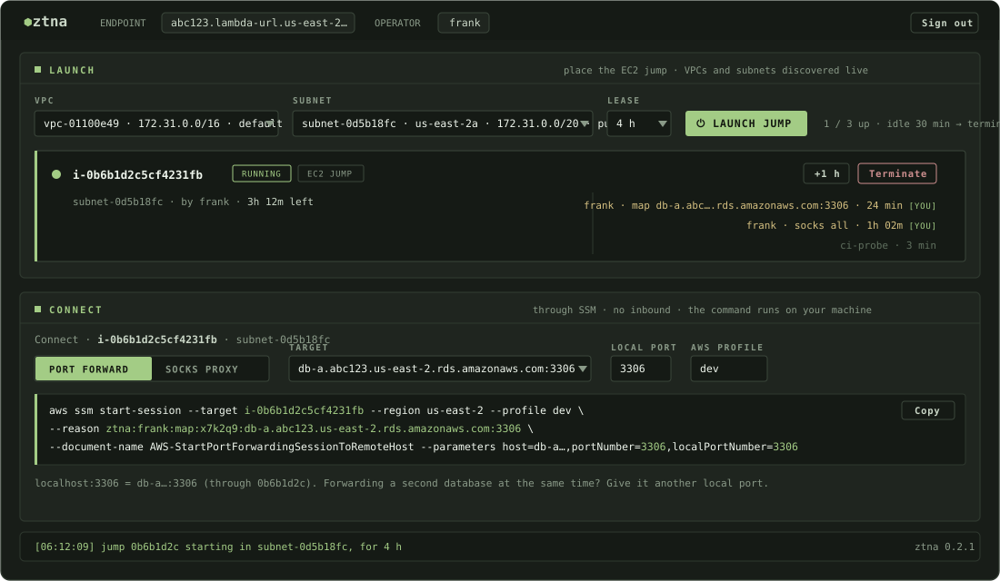
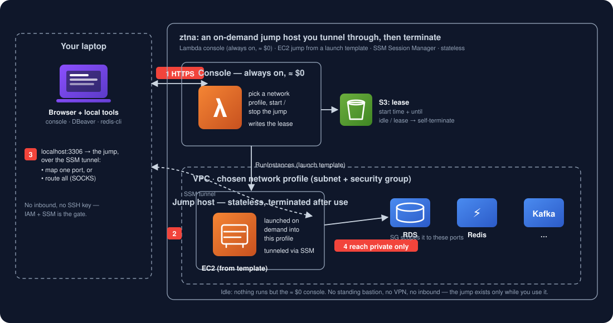

# ztna

**Zero-trust, on-demand access to private resources: a persistent ≈ $0 console starts a stateless jump host in the
network you pick, you tunnel through it — map a port to your laptop, or route like a VPN — and it is terminated when
you are done.** Part of [IdleFree](https://cloudformer.github.io/) · 中文：[README.zh.md](README.zh.md)

Replaces a standing bastion / AWS Client VPN. No always-on jump host, no VPN client, no SSH keys, no inbound ports —
IAM + SSM Session Manager are the only gate, and nothing runs (or costs) while nobody is connected.

## Two ways to use it

| Mode | What it does | For |
|---|---|---|
| **Port-forward** (map) | a private service appears on a local port — `localhost:3306` *is* the private RDS | a local GUI tool or script against one resource |
| **SOCKS proxy** (`ssh -D`) | all your traffic routes through the jump — reach the whole network, go out from its IP | browsing many internal services, or a session that exits from one IP |

Both use the **same jump host** and the **same SSM tunnel** — only how you connect from your laptop differs. One box,
two usages. The console lists every jump's **active SSM sessions** — who, mode, target, for how long: the generated
commands carry a `--reason ztna:<user>:<mode>:<token>:<target>` tag, and sessions started from your own browser are
marked **YOU**.

## Lifecycle — stateless, ≈ $0 idle

- The **console** is a Lambda behind a Function URL: always on, ≈ $0, the only persistent part.
- **Start** — pick a VPC and a subnet (discovered live); the console launches a jump host from an **EC2 launch
  template** there. A **lease** is written with the start time and a chosen duration.
- **No hard time limit** on the host (EC2); the lease is the cost guardrail. **Extend** it (+time) from the console
  while you work.
- **Idle shutdown** — no activity for `idle_shutdown_minutes` → the host is terminated.
- **Always terminated, never stopped.** The jump host is stateless and disposable: created fresh from the template,
  destroyed completely. Nothing is kept on it — configuration comes from the template (IaC), any results go to S3.
  A stopped, stateful box would defeat the point; IdleFree hosts are cattle, not pets.

## Networks — discovered live, picked at launch

The console's VPC and Subnet dropdowns are discovered live (`ec2:Describe*`, read-only): pick where the jump lands.
It launches with that VPC's **default security group**, and gets a public IP exactly when the subnet assigns them.
The map-mode Target dropdown lists the RDS and ElastiCache endpoints of the jump's VPC automatically (plus the
static `targets` extras from Terraform); a custom host:port can always be typed. What a jump can actually reach is
still decided by security groups in IaC — the page only picks among what exists, it can never define new access.

## Zero trust

Per-session sign-in (console + IAM), access scoped to one profile (and, in map mode, one service), only while needed,
terminated after, and fully logged (IAM + SSM session logs). No standing network, no implicit trust, nothing left behind.

## Status

**Design.** This README is the plan; the console, launch template and Terraform module are not built yet.

## License

MIT
