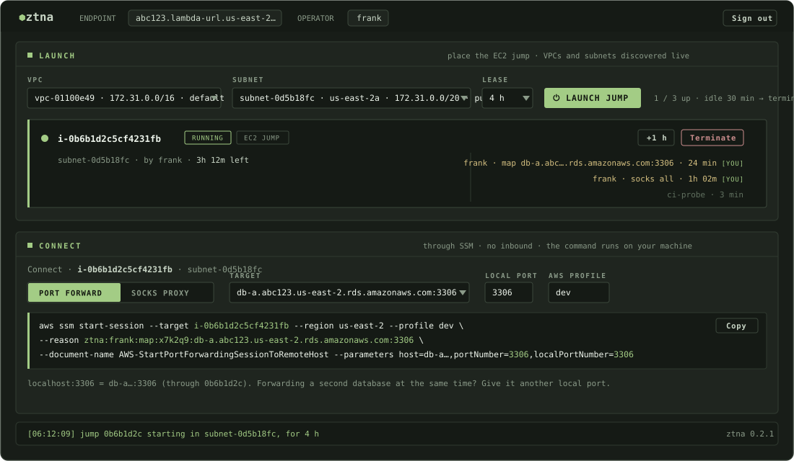
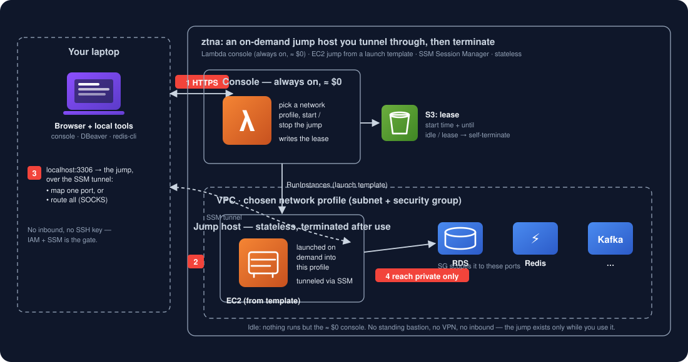

# ztna

**零信任、按需访问私有资源:一个常驻 ≈ $0 的控制台,在你选的网络里拉起一台无状态跳板,你穿过它——把端口映射到本机,
或像 VPN 一样整机走它——用完就彻底销毁。**
[IdleFree](https://cloudformer.github.io/) 系列 · English: [README.md](README.md)

替代常驻堡垒机 / AWS Client VPN。没有 7×24 的跳板、没有 VPN 客户端、没有 SSH key、没有入站端口——IAM + SSM
Session Manager 是唯一的闸门;没人连的时候,什么都不跑,也不花钱。

## 两种用法

| 模式 | 做什么 | 适合 |
|---|---|---|
| **端口映射** | 内网某服务出现在本机端口——`localhost:3306` 就是内网那台 RDS | 本地 GUI 工具/脚本连某一个资源 |
| **SOCKS 代理**(`ssh -D`) | 你的全部流量从跳板走——够到整个网络、从它的 IP 出网 | 逛多个内部系统,或整段会话从一个 IP 出去 |

两者用的是**同一台跳板**、**同一条 SSM 隧道**——只是你本机怎么连不同。一台机器,两种开法。控制台还会列出每台跳板
的**活跃 SSM 会话**(谁、什么模式、连的什么、多久了):生成的命令带 `--reason ztna:用户:模式:浏览器串:目标`,
你自己机器发起的会话标 **YOU**。

## 生命周期 —— 无状态,闲时 ≈ $0

- **控制台**是一个 Function URL 后面的 Lambda:常驻、≈ $0,是唯一持久的部分。
- **启动**——选 VPC 和子网(下拉实时发现),控制台从 **EC2 launch template** 把跳板拉进去。同时写一个**租约**,记下启动时间和选定时长。
- 跳板本身(EC2)**没有硬性时长上限**;租约是成本的保险丝。干活期间可以在控制台 **续时**(+时长)。
- **空闲自停**——超过 `idle_shutdown_minutes` 没有活动 → 跳板被销毁。
- **永远 terminate,绝不 stop。** 跳板是无状态、一次性的:从模版现拉、彻底销毁。机器上不留任何东西——配置来自模版(IaC),产物进 S3。
  一台 stop 下来、带状态的机器会违背初衷;IdleFree 的机器是"牛",不是"宠物"。

## 网络 —— 实时发现,启动时选

控制台的 VPC / 子网下拉是实时发现的(`ec2:Describe*`,只读):选跳板落在哪。跳板带上那个 VPC 的**默认安全组**,
子网自动分配公网 IP 时它才有公网 IP。Map 模式的 Target 下拉自动列出该 VPC 的 RDS / ElastiCache 端点
(外加 Terraform 里 `targets` 的静态补充);自定义 host:port 永远可输。跳板实际能连到什么,仍由 IaC 里的
安全组决定——页面只能在已存在的里面选,永远无法定义新的网络访问。

## 零信任

每会话登录(控制台 + IAM),访问限定在一个档位(映射模式下还限定到单个服务),只在需要时存在,用完销毁,全程留痕
(IAM + SSM 会话日志)。没有常驻网络、没有隐式信任、不留任何残留。

## 状态

**设计阶段。** 本 README 是方案;控制台、launch template、Terraform 模块都还没写。

## License

MIT
