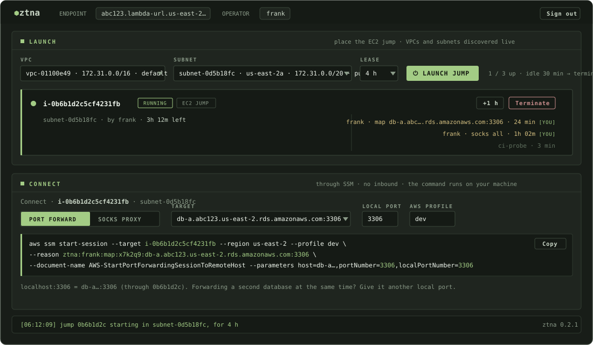
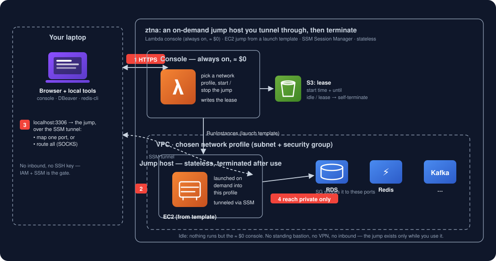

# ztna

**Zero-trust, on-demand access to private resources: a persistent ≈ $0 Lambda console starts a stateless EC2 jump
host in the network you pick, you tunnel through it over SSM — a port-forward to your laptop, or a SOCKS proxy — and it is terminated when you are done.** Part of [IdleFree](https://cloudformer.github.io/).

This package holds the service: the Lambda (web console + API) and the jump agent (self-terminate on lease / idle).
Deploy it with the Terraform module
[cloudformer/infra/aws//modules/ztna](https://registry.terraform.io/modules/cloudformer/infra/aws/latest/submodules/ztna),
which installs this package from PyPI. Project: [cloudformer/ztna](https://github.com/cloudformer/ztna).
